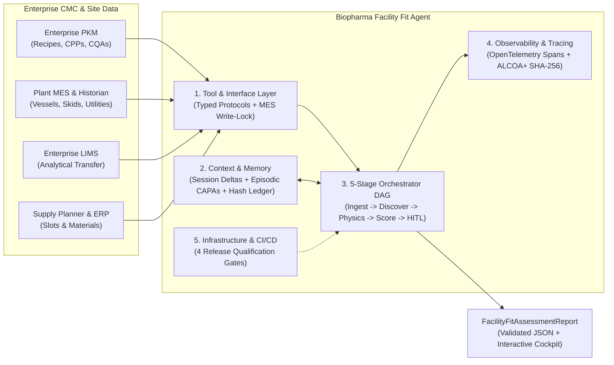

# Biopharma CMC Continuous Facility Fit Agent

An autonomous, **GxP-aware Non-GxP Decision-Support Engine** for evaluating bioprocess Chemistry, Manufacturing, and Controls (CMC) recipes against the physical, hydrodynamic, thermal, utility, analytical, and scheduling envelopes of receiving commercial manufacturing facilities prior to PPQ or commercial execution.

## Core Design Principles

- **Non-GxP Decision-Support Boundary**: Generates normalized fit indices, discrepancy matrices (`CRITICAL` / `MAJOR` / `MINOR`), and engineering mitigations. Autonomous shop-floor Plant MES setpoint writes and validated SOP overrides are deterministically blocked (`GxpBoundaryViolationError`).
- **100% Deterministic Transport Physics**: Never estimates physical engineering parameters heuristically. All hydrodynamic, mass-transfer, thermal, chromatography, and filtration evaluations execute unit-tested chemical engineering correlations.
- **Step-5 Human-in-the-Loop (HITL) Governance Gate**: Any assessment containing `MAJOR` or `CRITICAL` discrepancies automatically locks persistence (`persistence_locked: true`) until human Technical Sponsor adjudication is recorded.

## 5-Pillar Production Agent Architecture



| Architectural Pillar | Module | Implementation Highlights |
| :--- | :--- | :--- |
| **1. Tool & Interface Design** | `facility_fit_agent/tools.py` | Read-only `Protocol` interfaces, ADK / Vertex AI `ToolDeclaration` JSON Schema exports (`/api/tools`), and guarded `actuate_shop_floor_mes_setpoint` write-lock raising `GxpBoundaryViolationError`. |
| **2. Context & Memory** | `facility_fit_agent/memory.py` | `SessionWorkingContext` for counterfactual CPP overrides, `EpisodicPrecedentStore` for historical tech-transfer CAPA recall, and `AssessmentAuditLedger` SHA-256 hash-chaining. |
| **3. Orchestration & Logic** | `facility_fit_agent/orchestrator.py`, `facility_fit_agent/agent.py` | Deterministic 5-stage state machine (`STAGE_1_INGEST_AND_NORMALIZE` through `STAGE_5_GXP_HITL_AND_AUDIT_COMMIT`), multi-site fan-out, and `simulate_what_if`. |
| **4. Observability & Tracing** | `facility_fit_agent/observability.py` | Hierarchical `AgentTracer` spans (`trace_id`, `span_id`, `duration_ms`), `MetricsRegistry` latency/counter snapshots, and canonical SHA-256 ALCOA+ payload digests. |
| **5. Infrastructure & CI/CD** | `facility_fit_agent/cicd.py`, `facility_fit_agent/deployment_manifest.json` | 4-gate automated release qualification pipeline (`/api/cicd-gates`): Golden Physics Drift, GxP MES Write-Lock Red-Team, Schema & HITL Gate, and ALCOA+ Hash-Chain Integrity. |

## Quickstart

### Run Unit & Zero-Leakage CI Suite
```bash
./scripts/run_ci_checks.sh
```

### Launch Interactive Web Cockpit & REST API Locally
```bash
PORT=8080 python3 main.py
```
Then open `http://localhost:8080` in your browser.

### REST API Endpoints
- `GET /` — Interactive Facility Fit Decision-Support Cockpit UI
- `GET /healthz` — Service readiness and hash-chain integrity check
- `GET /api/assess?process_id=PKM-AB4821-DS-V4.2&target_site=ALL` — Multi-site orchestrated fit evaluation
- `POST /api/simulate-what-if` — Stateful counterfactual CPP override sensitivity check
- `POST /api/signoff` — Step-5 Technical Sponsor HITL signoff adjudication
- `POST /api/redteam-mes-write` — Verifies deterministic `HTTP 403` GxP MES write-lock
- `GET /api/tools` — Exports JSON Schema tool interface declarations
- `GET /api/cicd-gates` — Executes all 4 CI/CD release qualification gates

### Deploy to Google Cloud Run
```bash
gcloud run deploy biopharma-facility-fit-agent \
  --source . \
  --region us-central1 \
  --allow-unauthenticated
```
